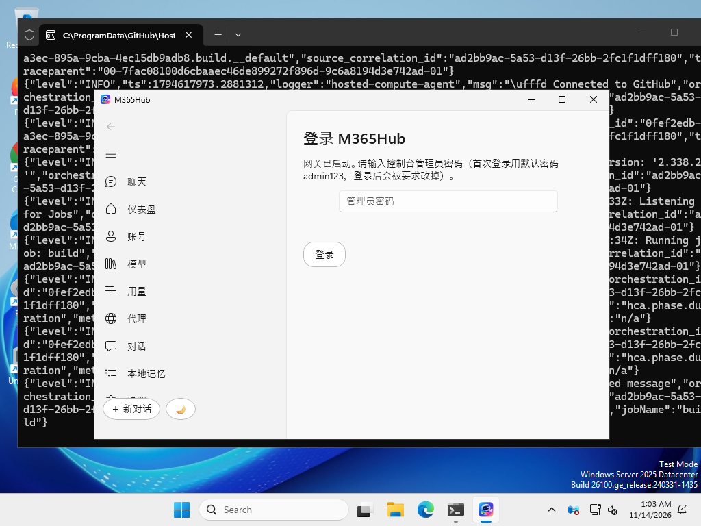
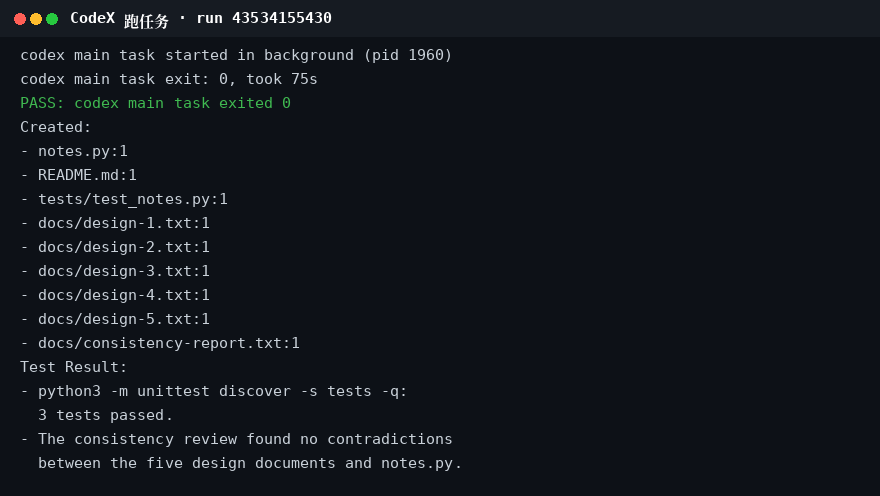
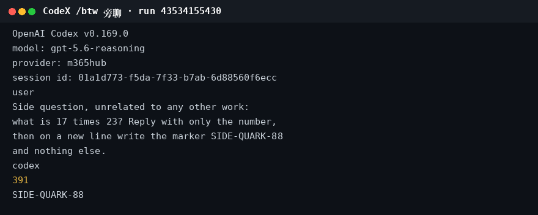
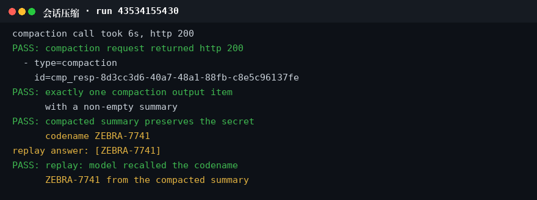
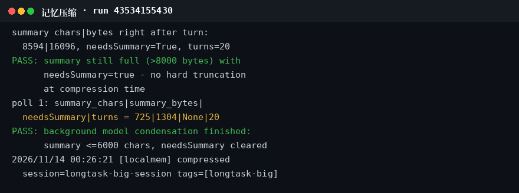

# M365Hub for Windows

[](https://github.com/ryc2077/M365Hub-win/actions/workflows/build.yml)
[最新发布](https://github.com/ryc2077/M365Hub-win/releases/latest)

M365Hub 的 Windows 原生客户端：WinUI 3 界面（C# + XAML）+ 自带 Go 网关，不套 Electron，不套 WebView。打开就是聊天。

三端同源：Mac 版是原生 SwiftUI，Android 版是原生 Java Views，网关是同一份 Go 程序。

## 截图



登录页（CI 实测截图，1.0.5 build）：左侧是聊天 / 仪表盘 / 账号 / 模型 / 用量 / 代理 / 对话 / 本地记忆，右侧输管理员密码登录。

## CodeX 实测

CodeX 经本网关跑长任务的实测（CI 终端输出，run 43534155430，2026-11-14；该跑 60 项通过，/btw 隔离 4 项全过）：



跑任务：75 秒跑完一个真任务（notes.py + 5 份设计文档 + 一致性报告），单测 3 个全过，exit 0。



/btw 旁聊：旁聊问 17×23，答 391，标记 SIDE-QUARK-88，主任务的代号没串进来。



会话压缩：一次 compaction 调用 6 秒，恰好回 1 个 compaction 项，摘要里留着代号 ZEBRA-7741，回放时模型能答出代号。



记忆压缩：110 条事实的记忆 8594 字符标 needsSummary，后台模型压成 725 字符，20 轮对话一条没截。

## 下载

[Releases](https://github.com/ryc2077/M365Hub-win/releases/latest) 里下 `M365Hub-winui-<版本>.zip`，解压即用，不用安装。

- `x64` 目录给 Intel / AMD 的机器，`arm64` 目录给 ARM64 的机器（Surface Pro X、Snapdragon X Elite 等）
- 两个目录里各带对应架构的网关 exe，应用启动时按本机 CPU 自动选

## 需要什么

- Windows 10 1809 或更高 / Windows 11（x64 或 ARM64）
- .NET 8
- Windows App Runtime 1.6（只装一次；没有它 WinUI 3 应用打不开。Microsoft Store 搜 "Windows App Runtime"，或到 https://learn.microsoft.com/windows/apps/windows-app-sdk/downloads 下 1.6 的安装包）

## 第一次用

1. 解压后按架构进 `x64` 或 `arm64` 目录，双击 `M365Hub.App.exe`。
2. 应用先 2 秒探测 `127.0.0.1:8230`：探到卡死的旧网关会自动清掉（只清 `m365hub` 进程）再重起；60 秒没应答会出失败屏，带重试和查看网关日志。
3. 输管理员密码登录（首次是默认密码 `admin123`，登录后会被要求改掉）。
4. 账号页 → 添加账号（PKCE）：授权链接会自动复制，浏览器打开 Microsoft 登录，完成后把地址栏的完整回调 URL 粘贴回来点确认。设备码是回退方式。
5. 聊天页顶栏可以指定账号（默认轮询，选了就只用那个号）；模型默认 `gpt-5.6-reasoning`。

## 功能

- 聊天：流式回复、数学公式原生渲染（TeX）、助手消息一键复制
- 多账号：PKCE + 设备码登录，多账号轮询，故障转移（一个号出问题自动换号重试），聊天可 pin 住某个账号
- 本地记忆：列表（key / 轮次 / 字数 / 已压缩）→ 点一条看摘要和全部轮次 → 支持删除；记忆超 8000 字符由模型真正压缩（浓缩到 6000 字符内），不是硬截断
- 会话压缩：长对话自动远程压缩，上下文不断
- 旁聊隔离：CodeX 的 `/btw` 旁聊与主任务隔离，互不串内容（1.0.5 修复）
- CodeX：经本地网关可用（YOLO、shell 工具调用）
- 仪表盘 / 用量 / 代理 / 云端对话

## 从源码构建

双击 `build.bat`（按本机 CPU 自动选 win-x64 或 win-arm64），或用 Visual Studio 的 MSBuild（WinUI 3 资源打包要 VS 自带的 Pri 任务，`dotnet build` 单独编会报 MSB4062）：

```bat
msbuild src\M365Hub.App\M365Hub.App.csproj -restore -p:Configuration=Release -p:Platform=x64 -p:RuntimeIdentifier=win-x64
msbuild src\M365Hub.App\M365Hub.App.csproj -restore -p:Configuration=Release -p:Platform=ARM64 -p:RuntimeIdentifier=win-arm64
```

产物在 `src\M365Hub.App\bin\x64\Release\net8.0-windows10.0.19041.0\win-x64\`（或 `bin\ARM64\Release\...\win-arm64\`），`M365Hub.App.exe`，旁边会自动带上两个网关 exe。

CI 在 GitHub Actions 里跑（`.github/workflows/build.yml`）：Core 测试、x64 / ARM64 编译、网关冷启动、安装 Windows App Runtime、应用启动（截图留证）、账号添加与对话、真实账号 PKCE + 真实对话、CodeX 工具调用；全绿才发版（`release.yml`）。

## 目录结构

- `src/M365Hub.App/` — WinUI 3 应用（MainWindow、Pages、Controls）
- `src/M365Hub.Core/` — 核心库（ApiClient、GatewayManager、GatewayProbe、Markdown / TeX）
- `scripts/` — CI 测试脚本（网关冷启动、账号对话、真实账号 PKCE、CodeX）
- `.github/workflows/` — `build.yml`、`release.yml`
- `build.bat` — 本地构建入口
- `README-winui.txt` — 随安装包发的纯文本版说明

## 数据存在哪

`%LOCALAPPDATA%\M365Hub\`：

- `data\` — 网关数据（账号、token、用量）
- `chat-history.json` — 聊天记录
- `chat-images\` — 聊天里的图片

数据在应用包外面，重装应用不丢数据。

## 版本

- **1.0.5**（2026-11-14）：修 BTW 旁聊泄漏——CodeX 的 `/btw` 旁聊与主任务共用同一个上游对话，旁聊内容会进主任务上下文；网关侧修：缺会话头时不再共用默认对话，旁聊走单独分支；网关重编。
- **1.0.4**（2026-11-13）：默认模型改 `gpt-5.6-reasoning`；网关重编（含模型压缩、choices 信封修复）；启动自愈（TcpClient 探测、卡死旧网关自动清理）；登录 10 秒超时 + “正在登录…”状态；测试脚本真实对话模型 6.1 → 5.6。
- 更早版本见 [Releases](https://github.com/ryc2077/M365Hub-win/releases)。

## 注意

- 默认模型是 `gpt-5.6-reasoning`：6.x 在基础版 Copilot 上会被 Premium license 拦；之前在应用里保存过 6.x 的，需在模型页手动切一次。
- Claude Code 在该租户的基础版许可下不可用（上游原样拒 `Claude isn't available with your current license`），换许可或换账号才能用，不是应用问题。
- 应用未签名；网关只监听 `127.0.0.1:8230`，不对外暴露。

## 相关

- Mac 版（原生 SwiftUI）：https://github.com/ryc2077/M365Hub-mac
